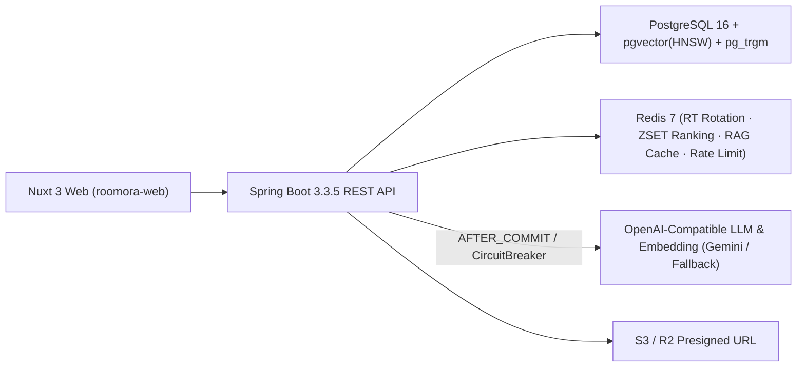

# Roomora Server (`roomora-server`)

> **Roomora (루모라)** — 조건 기반 인테리어 레시피 · 주간 콘테스트 · AI RAG 통합 검색 플랫폼의 Spring Boot 백엔드 서버입니다.

## 아키텍처 개요



## 핵심 엔지니어링 패턴
1. **DB 트랜잭션과 AI 색인 분리 (`AFTER_COMMIT`)**: 레시피·콘테스트 커밋 후(`TransactionPhase.AFTER_COMMIT`) 청킹·임베딩(`rag_document_chunk`)을 실행해 DB 커넥션 풀 점유를 차단하고 `chunk_index` 기준 멱등 Upsert를 보장합니다.
2. **외부 AI 장애 격리 (`Resilience4j` + 로컬 폴백)**: `@CircuitBreaker(name = "ragAi")` Fallback으로 LLM 장애 시에도 DB 조건·키워드 기반 `200 OK` (`fallback: true`)를 반환하며, 임베딩 장애 시 1536차원 결정적 로컬 벡터로 폴백합니다.
3. **단일 DB 하이브리드 검색 (`pgvector` HNSW + `pg_trgm` + RRF)**: 별도 Vector DB 없이 RDB 정형 조건 Pre-filtering(주거형태·예산·무타공) 후 벡터 코사인 유사도와 키워드 점수를 RRF로 결합합니다.
4. **동시성 정합성 & No-Offset Keyset 페이징**: 콘테스트 회차당 1인 1표(100스레드 동시성 테스트 통과) + Redis ZSET 실시간 랭킹, 전 정렬 기준(`LATEST`/`LIKES`/`SCRAPS`/`BUDGET_ASC`) Keyset 페이징을 지원합니다.

## 성능 실측 요약 (`EXPLAIN ANALYZE` & `k6`)

| 항목 | 비교 대상 | 실측 결과 |
| :--- | :--- | :--- |
| **레시피 Keyset vs Offset** (50,000건) | `id < 25000 LIMIT 20` vs `OFFSET 40000` | **`0.060 ms`** (`hit=6`) vs `12.021 ms` (`hit=948`) — **약 200배 빠름** |
| **`pgvector` HNSW 유사도 검색** (2,000건, 1536d) | `idx_rag_chunk_embedding_hnsw` | **`2.920 ms`** (`hit=160`) |
| **레시피 Keyset 목록 부하** (`k6`, 20 VUs) | `GET /api/recipes?sort=LATEST&size=20` | **~1,567 req/s**, **P95 `24.16 ms`**, 에러 `0.00%` |
| **콘테스트 ZSET 랭킹 부하** (`k6`, 20 VUs) | `GET /api/contests/rounds/1/ranking?limit=10` | **~1,806 req/s**, **P95 `18.21 ms`**, 에러 `0.00%` |
| **RAG 검색 Redis Cache Hit** (`k6`, 20 VUs) | `POST /api/search/rag` | **~3,496 req/s**, **P95 `9.53 ms`** (Live Gemini `21,265ms` 대비 단축) |

## 기술 스택
- **Backend**: Java 17, Spring Boot 3.3.5, Spring Security (JWT + OAuth2 Kakao/Google), Spring Data JPA (`Specification`), Flyway
- **Database & Cache**: PostgreSQL 16 (`pgvector`, `pg_trgm`), Redis 7
- **AI & Resilience**: OpenAI-compatible `RestClient` (Gemini / OpenAI), Resilience4j 2.2.0
- **Test & Load**: JUnit 5, Docker 실컨테이너 통합 테스트(28건), Grafana `k6`

## 실행 및 검증
```powershell
docker compose up -d
pwsh -File scripts/verify.ps1
```

## 문서 & 에이전트 하네스
- 공용 설계 문서(옵시디언 L0~L3): `../dev-obsidian-base/10_Projects/roomora/`
- 에이전트 작업 규칙: [AGENTS.md](./AGENTS.md) · [CLAUDE.md](./CLAUDE.md)
